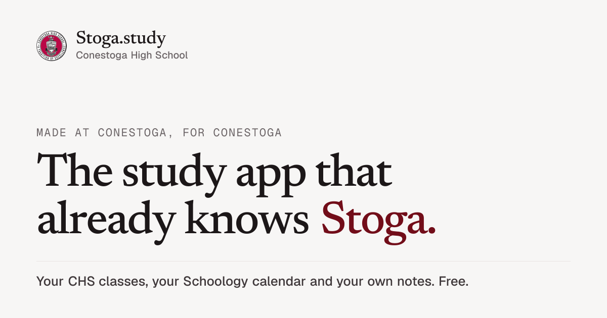

# Stoga.study

The free study app made for Conestoga High School. Your CHS classes, your Schoology calendar and your own notes, in one place.

**[Open the app](https://beta.stoga.study)** · [Website](https://stoga.study) · [Updates in 60 seconds](https://stoga.study/video) · [What's new](https://beta.stoga.study/updates) · [Known issues](https://beta.stoga.study/known-issues)

## What it does

- **CHS classes built in.** Every core course from the Program of Studies is already there. Pick yours and you're set up in about a minute.
- **Plans around real test dates.** Import your Schoology calendar and get a nightly plan built around the tests and homework you actually have.
- **Studies from your notes.** Upload PDFs, slides or photos of handouts. Flashcards, quizzes and tutor answers come from that material, with the page linked.
- **A tutor that hints first.** It helps you work it out, and only gives the full explanation when you ask.
- **Study together, safely.** Invite-only groups, first names only, no chat between students.
- **Private by design.** Export or delete everything, see exactly what the AI uses, and share a read-only progress page with a parent if you want to.

## Where it's at

Public beta since October 2026. Nine updates (1.1 to 1.9) shipped in the first month, each one shaped by feedback from Conestoga students. Every release is listed on the [public changelog](https://beta.stoga.study/updates).

## Repositories

| Repository | What's in it |
| --- | --- |
| [landing](https://github.com/stoga-study/landing) | The [stoga.study](https://stoga.study) website (Next.js, fully static) |

## Feedback

Found a bug or have an idea? Use **Send feedback** on any screen in the app, or vote on the ideas board. Students read every report, and most fixes ship within a day.

---

Built by Conestoga students, for Conestoga students. Stoga.study is not an official service of Conestoga High School or the Tredyffrin/Easttown School District. Code is MIT licensed; the Stoga.study name, logo and the Conestoga High School seal are not covered by that license.
